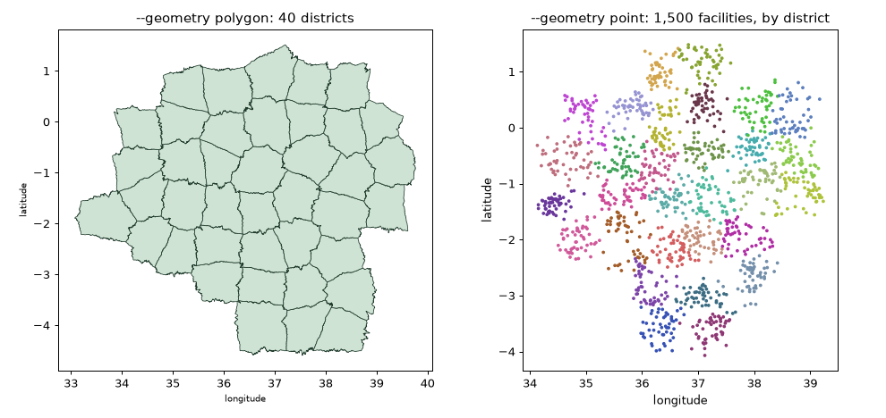

# Generating your own

`chap-test-data generate NAME` writes one dataset of any size and shape:

```bash
uv run chap-test-data generate my-test --org-units 5000 \
  --years 5 --period monthly
uv run chap-test-data generate districts --org-units 300 \
  --geometry polygon --format geojson
uv run chap-test-data generate malaria --column malaria_cases \
  --column population --column precipitation
uv run chap-test-data generate gaps --org-units 50 \
  --covariate-gaps 5 --drop-locations 2
uv run chap-test-data generate --help
```

The name is the folder the dataset is written to, under `datasets/` (change it with `--out`).
All options are optional.
For a ready-made set to start from, see [Ready-made datasets](ready-made.md).

## Options

### Size and time

| Option | Default | What it does |
| --- | --- | --- |
| `--org-units N` | 100 | How many org units (districts or facilities) the dataset has. |
| `--period weekly` or `--period monthly` | weekly | How often there is a value: once a week (periods like `2016W01`) or once a month (`201601`). |
| `--years N` | 10 | How many years of data, starting in `--start-year`. |
| `--periods N` | | How many weeks or months exactly, instead of `--years`. `--periods 36 --period monthly` is 3 years. |
| `--start-year YEAR` | 2016 | The year the data starts. |

### Value columns

| Option | Default | What it does |
| --- | --- | --- |
| `--columns N` | 10 | How many value columns, taken in this order: disease_cases, population, rainfall, mean_temperature, min_temperature, max_temperature, relative_humidity, soil_moisture, ndvi, elevation. Above 10 you get covariate_11, covariate_12 and so on. |
| `--column NAME` | | Name the value columns yourself, one `--column` per column, in order. The first is the target (what models predict). Names from the list above get realistic values; other names get a seasonal covariate between 0 and 100. Replaces `--columns`. |
| `--missing SHARE` | 0.002 | Leaves some case counts empty, at random, as weeks or months with no report would be. The share is a fraction: 0.002 is about 1 value in 500, 0 leaves none empty. Chap accepts empty case counts, so these org units are still imported (a gap in a covariate is different: see `--covariate-gaps`). The case counts are the target, the first value column. |

### Locations

| Option | Default | What it does |
| --- | --- | --- |
| `--geometry point` | default | Each org unit is a point, like a health facility. |
| `--geometry polygon` | | Each org unit is an area, like a district, with a jagged border shared with its neighbours. |
| `--corners N` | 800 | How many points each area's border has, with `--geometry polygon`. More points draw a more detailed border and make the file larger. |
| `--geojson` | | Write the locations only as `locations.geojson`, not as `locations.parquet`. Use it to test a GeoJSON upload. |

### Other formats

| Option | Default | What it does |
| --- | --- | --- |
| `--format FORMAT` | | Also write the dataset in another format; repeat for several. `csv`, `geojson`, `json-columns` or `json-rows`; see [Formats](#formats). Parquet is always written. |

### Settings in the file

These go into the observations file's `chap.*` metadata, which Chap reads as the dataset's
settings.

| Option | Default | What it does |
| --- | --- | --- |
| `--masked START:END` | | Hide the target between two periods, for example `--masked 201801:201803`, as a dataset with known bad data would. Repeat for several ranges. |
| `--no-metadata` | | Write no `chap.*` settings. Chap then names the dataset after the file and uses its defaults. |
| `--spec-version VERSION` | 1 | The file format version written to the file. Chap only reads version 1, so anything else is refused. |
| `--about TEXT` | | A description stored in `expected.json`. Without it, one is made from the settings. |

### Org units Chap must reject

Chap accepts the dataset but leaves these org units out, and says which and why.
`expected.json` counts them as rejected.

| Option | Default | What it does |
| --- | --- | --- |
| `--covariate-gaps N` | 0 | The first N org units each miss one value in the last value column. Chap rejects an org unit with a gap in a covariate. |
| `--drop-locations N` | 0 | The last N org units have data but no location in the locations file. Chap rejects an org unit it cannot place on the map. |

### Files Chap must refuse

Chap refuses the whole upload with an error (HTTP 422). `expected.json` holds the error to expect.

| Option | Default | What it does |
| --- | --- | --- |
| `--duplicate-rows N` | 0 | The first N rows are written twice, so an org unit has two values for the same period. |
| `--text-column NAME` | | Adds a column with this name holding text instead of numbers. |
| `--drop-time-period` | | Leaves out the `time_period` column, so Chap cannot tell when the values are from. |
| `--not-parquet` | | Writes a CSV file named `observations.parquet`, as a wrongly saved file would be. |

### Reproducing a dataset

| Option | Default | What it does |
| --- | --- | --- |
| `--seed N` | random | The same seed and options always give the same files. Without it a random seed is used, and `expected.json` records it, so you can make the same dataset again. |
| `--out FOLDER` | `datasets` | The folder the dataset folder is written in. |

The observations are written in batches of org units, so memory stays small: 52 million rows
take about 25 s and 650 MB. The other formats are converted from the Parquet files in batches
too.

## Formats

| `--format` | Files |
| --- | --- |
| (always) | `observations.parquet`, `locations.parquet`, and `hierarchy.geojson`: the country, regions and districts above the org units |
| `geojson` | `locations.geojson` |
| `csv` | `observations.csv` (time_period, location, then the values) and `locations.geojson` |
| `json-columns` | `make-dataset.columns.json`: the `make-dataset` body with `providedDataColumns`, as the Modeling App sends today |
| `json-rows` | `make-dataset.rows.json`: the older body, one object per value |

## The values

Values follow chapkit's `TestDataGenerator`, so models tested with either tool see the same
ranges:

| Column | Values |
| --- | --- |
| population | 50,000 to 1.5 million, fixed per org unit |
| rainfall | 150 +/- 130 mm per period, following each org unit's own season |
| mean_temperature | 24 +/- 7 °C on a regional cycle; min and max 4 to 8 °C below and above |
| disease_cases | a per-org-unit level that follows the season, plus 0.06 x rainfall |
| other covariates | seasonal, between 0 and 100 |

The schema is Chap's, not chapkit's: periods as Chap stores them (`2016W01`, `201601`, with real
ISO weeks, so some years have a week 53) and DHIS2-style org unit ids.

## The map



- **Districts** (`--geometry polygon`) tile a country-like map near Nairobi: no gaps, no
  overlaps, and jagged borders shared by both neighbours. A border has about 800 points by
  default, the median of chap-core's example boundaries, and is about 1.7 times as long as a
  circle of the same area, as real borders are (1.4 to 1.9 in those files).
- **Facilities** (`--geometry point`) cluster around a few towns in each district, always inside
  it: about 50 facilities per district.
- Polygons follow the GeoJSON right-hand rule (RFC 7946): outer rings run counter-clockwise.

## The hierarchy

As in DHIS2, the org units sit in a tree of areas, written to `hierarchy.geojson`:

| Level | Area | With `--geometry polygon` | With `--geometry point` |
| --- | --- | --- | --- |
| 1 | Country | in `hierarchy.geojson` | in `hierarchy.geojson` |
| 2 | Regions, about 10 districts each | in `hierarchy.geojson` | in `hierarchy.geojson` |
| 3 | Districts | the org units, in `locations.*` | in `hierarchy.geojson`, about 50 facilities each |
| 4 | Facilities | | the org units, in `locations.*` |

Every area and org unit has a `level`, and a `parent`: the id of the area one level up that it
lies inside. The country has no parent. The areas of each level tile the whole country, and each
region is a single piece. Open `hierarchy.geojson` with `locations.geojson` in a map tool to see
the org units inside their districts and regions.

