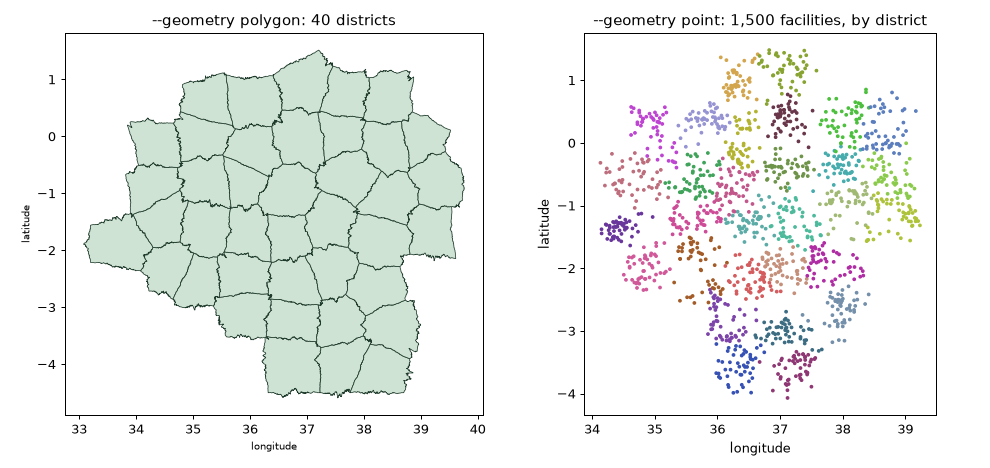

# chap-test-data

Synthetic datasets for [Chap](https://chap.dhis2.org), at any size, and the tools to send them
to Chap and check its answers.

- **Generate** datasets from 10 to 100,000 org units over any number of years, weekly or
  monthly, with cases, covariates and climate data. Written as Parquet and GeoParquet, and on
  request as CSV, GeoJSON and the `make-dataset` JSON bodies the Modeling App sends today.
- **Know the answer in advance.** Each dataset comes with an `expected.json`: what Chap should
  answer, including for the files it must reject.
- **Upload and check** against a running Chap, directly or through a DHIS2 route, with the Python
  command line or with plain curl.
- **Compare** Parquet uploads with today's JSON uploads, on a fast link or a slow, distant one.



## In one minute

```bash
git clone https://github.com/dhis2-chap/chap-test-data && cd chap-test-data
uv sync
./generate-datasets.sh --standard-only        # 16 datasets in datasets/, the same every time
uv run chap-test-data generate my-country --org-units 300 --geometry polygon --format geojson
uv run chap-test-data check                   # needs a running Chap; see Getting started
```

## A dataset

Every dataset is a folder of files describing the same data:

| File | What it holds |
| --- | --- |
| `observations.parquet` | One row per org unit and period: `location`, `time_period`, then one numeric column per value. The dataset settings are in the file's `chap.*` metadata. |
| `locations.parquet` | GeoParquet: one row per org unit with `location`, `name`, `parent`, `level` and the geometry. |
| `locations.geojson` | The same locations as GeoJSON (`--format geojson`). |
| `make-dataset.columns.json` | The same dataset as the JSON body the Modeling App sends today (`--format json-columns`). |
| `expected.json` | What Chap should answer to a dry run of the Parquet files, and the seed used. |

The file format and its metadata keys are described in chap-core's
[dataset files documentation](https://github.com/dhis2-chap/chap-core/blob/feat/dataset-parquet-upload/docs/webapi/dataset-files.md).
